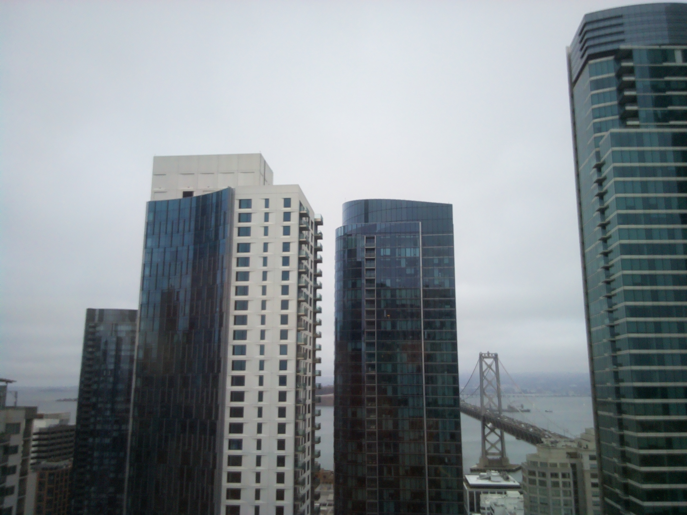
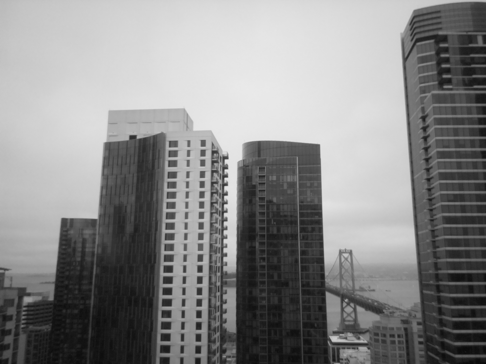

# Simple Raspberry Pi Color + B&W Camera

A compact digital camera for a Raspberry Pi Zero, Pi Camera Module v1.3,
1.14-inch IPS display, and UPS-Lite. The display provides a live viewfinder,
while a single physical shutter button captures matching full-resolution color
and black-and-white JPEGs from the same exposure.

Each press saves two files:

```text
20260920_142530_123456_color.jpg
20260920_142530_123456_bw.jpg
```

The color file is saved first. The B&W file is a neutral grayscale conversion
of the exact same captured pixels; it is not a second exposure.

## Sample capture

| Color | Black & white |
|---|---|
|  |  |

## Features

- Live 240x135 color viewfinder with a center-cropped 16:9 preview
- Quick shutter-frame and flash animation when a capture starts
- Full 2592x1944 capture from the Camera Module v1.3
- Matching color and neutral black-and-white JPEGs from the same exposure
- Automatic exposure and white balance
- High-quality JPEG output at quality 95
- Simple one-button shutter with no touchscreen or desktop environment required
- Automatic startup through systemd

## Hardware target

- Raspberry Pi Zero W or Zero 2 W
- Raspberry Pi Camera Module v1.3 (OV5647, fixed focus, 2592x1944 stills)
- 1.14-inch 240x135 IPS SPI LCD using the ST7789 controller
- UPS-Lite for Raspberry Pi Zero
- Normally-open momentary shutter switch

UPS-Lite supplies power only and needs no integration in the app. Shut Raspberry
Pi OS down cleanly over SSH before switching off the UPS-Lite; the shutter has
no secondary or long-press action.

## Wiring

The display is the eight-pin, 1.14-inch 240x135 IPS module with an ST7789
controller and pins labelled `GND VCC SCL SDA RES DC CS BLK`. Despite their
names, `SCL` and `SDA` carry SPI clock and data; do not connect them to the Pi's
I2C pins. GPIO numbers below are BCM numbers.

| Part | Module label | Pi function | Physical pin |
|---|---|---|---:|
| LCD | GND | Ground | 6 |
| LCD | VCC | 3.3 V | 1 |
| LCD | SCL | GPIO11 / SPI0 SCLK | 23 |
| LCD | SDA | GPIO10 / SPI0 MOSI | 19 |
| LCD | RES | GPIO27 | 13 |
| LCD | DC | GPIO25 | 22 |
| LCD | CS | GPIO8 / SPI0 CE0 | 24 |
| LCD | BLK | GPIO18 | 12 |
| Shutter | one terminal | GPIO26 | 37 |
| Shutter | other terminal | Ground | 39 |

Use 3.3 V for the display supply and logic. No MISO wire is required because
the LCD only receives data. The app drives `BLK` high after initialization and
low during shutdown; do not connect `BLK` to both GPIO18 and 3.3 V. Switch off
and disconnect Pi power before changing any wiring.

The shutter uses the Pi's internal pull-up. Do not add a connection to 3.3 V.

Connect the Camera Module v1.3 to the Pi Zero's CSI connector with the Pi
powered off. This requires a Pi Zero 22-pin-to-15-pin camera cable rather than a
standard 15-pin cable. Seat both ends squarely and close both locking tabs.

## Raspberry Pi OS setup

Use current Raspberry Pi OS Lite. Enable the camera and SPI interface:

```bash
sudo raspi-config
```

Under **Interface Options**, enable SPI. Current Raspberry Pi OS camera support
uses libcamera/Picamera2 and normally needs no legacy-camera setting. Reboot,
then install the platform packages:

```bash
sudo apt update
sudo apt install -y python3-picamera2 python3-opencv python3-numpy \
  python3-gpiozero python3-spidev
```

Copy or clone this repository into the Pi user's home directory, then verify the
app before installing the service:

```bash
cd ~/rpi-simple-camera
python3 camera.py
```

Pictures are written to `~/Pictures`, which is created automatically.
Stop the manual run with `Ctrl+C`.

To copy all captured JPEGs to another computer on the same network, run this on
that computer and replace the destination path as needed:

```bash
scp 'YOUR_USER@raspberrypi.local:~/Pictures/*.jpg' ~/Desktop/
```

## Start automatically at boot

```bash
sudo cp systemd/rpi-simple-camera.service /etc/systemd/system/
sudo systemctl daemon-reload
sudo systemctl enable --now rpi-simple-camera.service
```

The bundled service file assumes the Pi username is `pi` and the repository is
at `/home/pi/rpi-simple-camera`. If either differs, update `User`,
`WorkingDirectory`, and `ExecStart` in the service file before installing it.

This is a console service and does not need X11, Wayland, a desktop session, or
a framebuffer mirror. The app sends the 240x135 preview directly to the ST7789
over SPI.

Useful diagnostics:

```bash
sudo systemctl status rpi-simple-camera.service
sudo journalctl -u rpi-simple-camera.service -f
rpicam-hello --list-cameras
ls -l /dev/spidev0.0
```

Run the small image-helper test suite on the Pi with:

```bash
python3 -m unittest discover -s tests
```

Display pins, orientation, and other hardware constants are kept near the top
of `camera.py` and `st7789.py` for straightforward customization.
